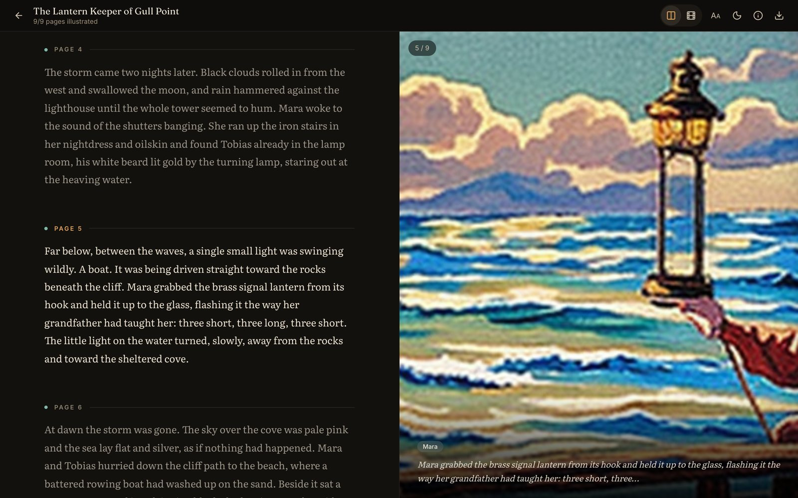
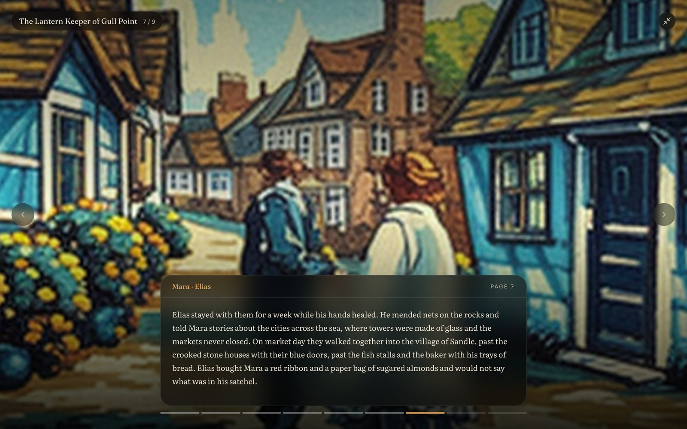
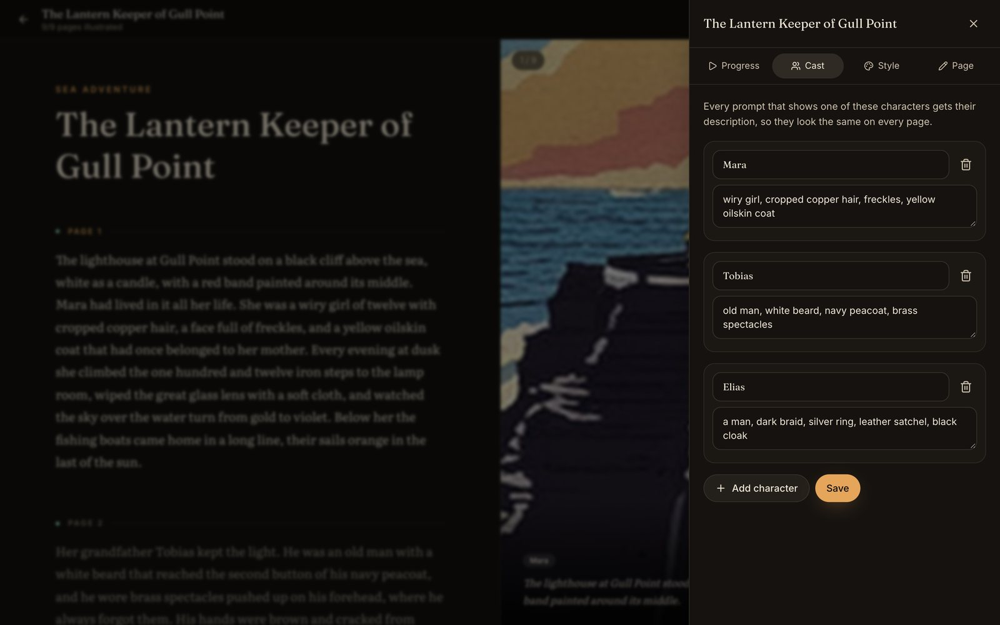
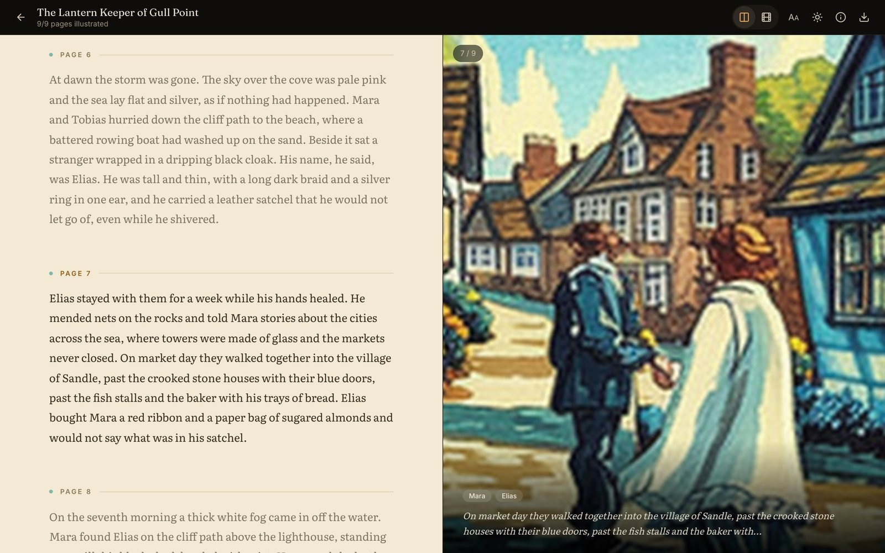
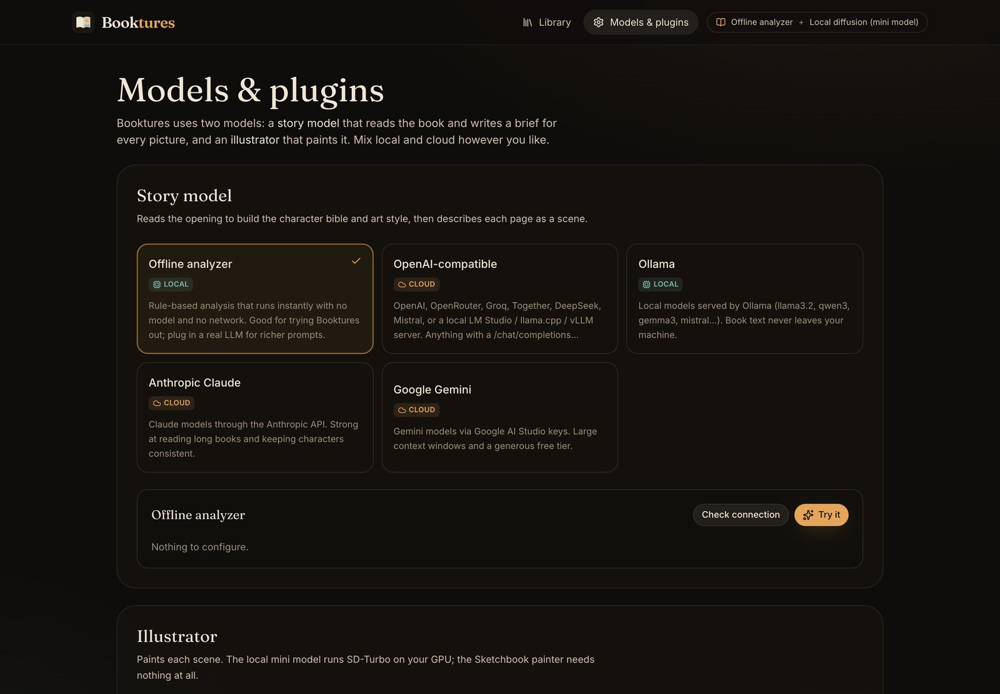
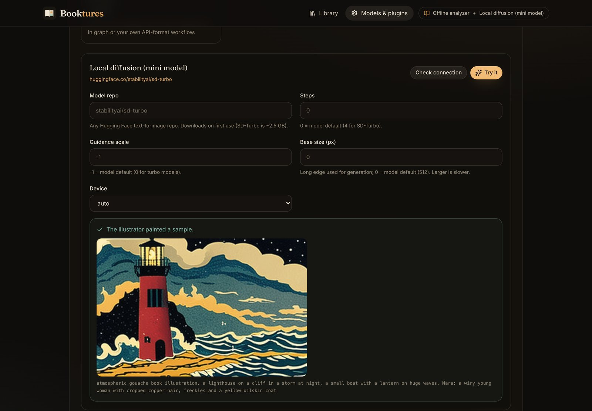
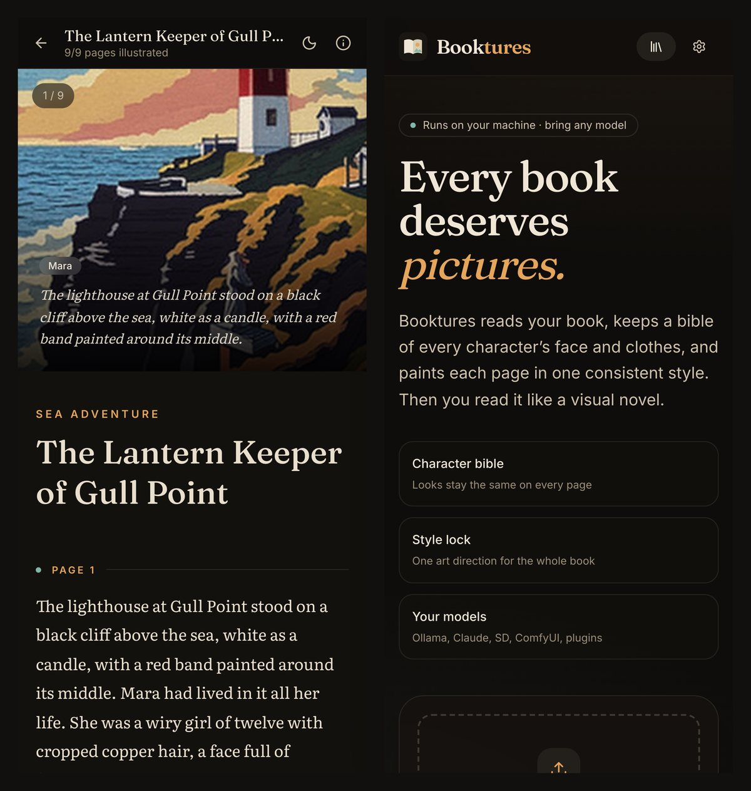
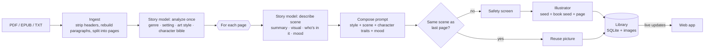

<div align="center">


# Booktures

**Turn any book into an illustrated visual novel, using the LLM and image model of your choice.**

Booktures reads your PDF, EPUB or text file, keeps a *character bible* so faces and clothes stay consistent, and paints every page in one art style. It runs on your machine. Use the built-in local model, connect a cloud API, or write a 30-line plugin for anything else.

[Quick start](#quick-start) · [Models](#models) · [Plugins](#plugins) · [CLI](#command-line) · [Docker](#docker) · [How it works](#how-it-works) · [Plugin guide](docs/PLUGINS.md)

[](https://github.com/pronzzz/booktures/actions/workflows/ci.yml)

[](LICENSE)


</div>

## Features

- **Read alongside the pictures.** Split view keeps the illustration pinned next to the text and changes it as you scroll. Cinema mode plays the book full-screen like a visual novel, with a slow Ken Burns pan.
- **Consistent characters.** The story model writes a description of every character's face and clothes once, and that description goes into every prompt they appear in. You can edit any description, then repaint the book with one click.
- **One style for the whole book.** Choose Watercolor, Ink & wash, Gouache, Noir comic, Woodcut, Pixel art and more, write your own, or let the story model pick a style that suits the genre.
- **Bring any model.** Booktures ships with 5 story models and 7 illustrators, from fully offline to hosted APIs, and a [plugin API](docs/PLUGINS.md) for anything else.
- **Includes a local image model.** One click runs [SD-Turbo](https://huggingface.co/stabilityai/sd-turbo) on your own GPU at about 2 seconds a picture on an Apple M4, with no account and no API cost.
- **Works fully offline.** The rule-based story analyzer and the procedural Sketchbook painter need no model and no network, so a fresh install works immediately.
- **Watch it work.** Pages fill in live as they're painted. You can pause, resume, or repaint a single page with your own prompt.
- **Skips repeated pictures.** When consecutive pages show the same scene, such as a long conversation in one room, Booktures reuses the picture instead of painting it again.
- **Export to one HTML file.** The export includes the images, works offline, and can be shared anywhere.
- **Handles real books.** It reads PDF (with headers and page numbers removed, and OCR for scanned pages if Tesseract is installed), EPUB, TXT and Markdown.

<table>
  <tr>
    <td width="50%"><br /><sub><b>Split view.</b> The picture follows the paragraph you're reading.</sub></td>
    <td width="50%"><br /><sub><b>Cinema mode.</b> Full-screen pictures with a visual-novel text box. Use ← → to turn pages.</sub></td>
  </tr>
  <tr>
    <td width="50%"><br /><sub><b>Character bible.</b> Every prompt with Mara in it gets the same description of her.</sub></td>
    <td width="50%"><br /><sub><b>Reading themes.</b> Night, sepia and paper, with 5 text sizes.</sub></td>
  </tr>
  <tr>
    <td width="50%"><br /><sub><b>Models &amp; plugins.</b> Pick a story model and an illustrator. Plugins appear here too.</sub></td>
    <td width="50%"><br /><sub><b>Try it.</b> Test any model with one real call before using it on a whole book.</sub></td>
  </tr>
</table>

<p align="center"></p>

## Quick start

You need **Python 3.10 or newer**. The commands below use [uv](https://docs.astral.sh/uv/); `pipx` or `pip` work the same way.

```bash
# The app with the offline and cloud models (small download)
uv tool install "booktures @ https://github.com/pronzzz/booktures/releases/download/v2.0.0/booktures-2.0.0-py3-none-any.whl"

# …or with the local SD-Turbo image model included (adds PyTorch, about 2 GB)
uv tool install "booktures[local] @ https://github.com/pronzzz/booktures/releases/download/v2.0.0/booktures-2.0.0-py3-none-any.whl"

booktures
```

Your browser opens at <http://localhost:8765>. Click **Try the sample story** to see a result in a few seconds, or drop in a book.

Then open **Models & plugins** and choose your models. Some common setups:

| You have | Story model | Illustrator |
| --- | --- | --- |
| Nothing, just trying it out | Offline analyzer | Sketchbook (offline) |
| A Mac with Apple silicon or an NVIDIA GPU | Ollama (e.g. `qwen3`) | Local diffusion (SD-Turbo) |
| An OpenAI, Anthropic or Gemini key | That provider | Local diffusion or Pollinations (free) |
| ComfyUI or SD WebUI already set up | Any | ComfyUI / SD WebUI, with your own checkpoints and LoRAs |

<details>
<summary><b>Install from source</b></summary>

```bash
git clone https://github.com/pronzzz/booktures && cd booktures
python3 -m venv .venv && source .venv/bin/activate
pip install -e ".[local,dev]"
(cd frontend && npm ci && npm run build)   # builds the web app into booktures/web
booktures
```

For frontend work, run `booktures serve --no-browser` in one terminal and `npm run dev` in `frontend/` in another. Vite serves the app on <http://localhost:5173> and forwards API calls to the Python server.
</details>

## Models

Booktures uses two models. A **story model** reads the book once to build the character bible and art style, then turns each page into a short visual brief. An **illustrator** paints each brief.

### Story models

| Provider | Runs | Notes |
| --- | --- | --- |
| **Offline analyzer** | Local | Rule-based. Finds characters and their descriptions, guesses the genre, and picks the most visual sentence on each page. Instant, with no setup. |
| **OpenAI-compatible** | Cloud or local | OpenAI, OpenRouter, Groq, Together, DeepSeek and Mistral are presets, as are LM Studio, llama.cpp, vLLM, and Ollama's `/v1` endpoint. Works with any `/chat/completions` server. |
| **Ollama** | Local | Uses Ollama's native API in JSON mode. Book text never leaves your machine. |
| **Anthropic Claude** | Cloud | Uses the official SDK (`pip install "booktures[anthropic]"`). Defaults to `claude-opus-5-5` at low effort. |
| **Google Gemini** | Cloud | Gemini API, default `gemini-flash-latest`. |

### Illustrators

| Provider | Runs | Notes |
| --- | --- | --- |
| **Sketchbook** | Local | A procedural painter that draws skies, coastlines, forests, towns, interiors, weather and figures from the prompt. It needs no model and is the right choice for testing your setup. |
| **Local diffusion (mini model)** | Local | Runs [SD-Turbo](https://huggingface.co/stabilityai/sd-turbo) through 🤗 diffusers on CUDA, Apple MPS or CPU. Presets for SDXL-Turbo, LCM Dreamshaper and SD 1.5, or enter any Hugging Face repo. Run `booktures download-model` to fetch the weights before you go offline. |
| **Pollinations** | Cloud | Free FLUX images with no sign-up. Prompts are sent to pollinations.ai. |
| **OpenAI Images** | Cloud | `gpt-image-1`, DALL·E 3, or a compatible server. |
| **Stability AI** | Cloud | Stable Image Core, Ultra and SD 3.5. |
| **SD WebUI** | Local | AUTOMATIC1111, Forge or SD.Next, with your checkpoints, samplers and LoRAs. |
| **ComfyUI** | Local | A built-in graph, or paste your own API-format workflow with `{{prompt}}`, `{{seed}}`, `{{width}}` and similar placeholders. |

API keys are stored in `~/.booktures/settings.json`, readable only by your user. The web app only ever shows the last 4 characters. Each key field also reads the usual environment variable (`OPENAI_API_KEY`, `ANTHROPIC_API_KEY`, `GEMINI_API_KEY`, `STABILITY_API_KEY`, `OLLAMA_HOST`) when it's left empty.

## Plugins

Any LLM or image model can be added with one Python file. Save this as `~/.booktures/plugins/my_painter.py` and restart Booktures:

```python
import httpx
from booktures.plugins import Field, ImageProvider, ImageRequest, register

@register
class MyPainter(ImageProvider):
    id = "my-painter"
    name = "My painter"
    local = True
    fields = [Field("url", "Server URL", type="url", default="http://127.0.0.1:7000")]

    def generate(self, request: ImageRequest) -> bytes:
        r = httpx.post(f"{self.config['url']}/txt2img", json={"prompt": request.prompt, "seed": request.seed}, timeout=300)
        r.raise_for_status()
        return r.content  # PNG, JPEG or WebP bytes
```

It appears under **Models & plugins** with its own settings form and its own **Check connection** and **Try it** buttons. A story model is the same, except you subclass `TextProvider` and implement `complete_json(system, user) -> dict`. Booktures writes the prompts and checks the replies.

- [`docs/PLUGINS.md`](docs/PLUGINS.md) is the full guide: settings fields, errors, optional dependencies, and publishing a plugin to PyPI with an entry point.
- [`plugins/hf_inference.py`](plugins/hf_inference.py) is a complete example illustrator for Hugging Face Inference Providers (FLUX.1-schnell by default).
- Plugins load from `~/.booktures/plugins`, from any `--plugins DIR`, from `$BOOKTURES_PLUGINS`, and from installed packages with a `booktures.plugins` entry point. A plugin that fails to load is listed with its traceback instead of crashing the app.

## Command line

```bash
booktures                                   # start the web app (same as `booktures serve`)
booktures serve --port 9000 --no-browser    # choose a port; don't open a browser
booktures providers                         # list story models, illustrators and plugin errors
booktures download-model                    # fetch SD-Turbo now, for offline use later

# Illustrate a book without the web app and write one standalone HTML file
booktures convert book.epub -o book.html --text ollama --image diffusers --style watercolor
booktures convert story.pdf --max-pages 10 --custom-style "linocut print, two colours"

# Global options
booktures --data-dir ./my-library --plugins ./my-plugins serve
```

Environment variables:

| Variable | Meaning |
| --- | --- |
| `BOOKTURES_HOME` | Where the library, settings and plugins live. Default `~/.booktures` |
| `BOOKTURES_PORT` | Default port for `serve` |
| `BOOKTURES_PLUGINS` | Extra plugin folders, separated by `:` (`;` on Windows) |
| `BOOKTURES_TEXT_PROVIDER`, `BOOKTURES_IMAGE_PROVIDER` | Override the selected providers, e.g. on a server |

## Docker

```bash
docker compose up -d          # http://localhost:8765
```

The image includes the cloud, Ollama, ComfyUI, SD WebUI and offline providers. To reach models running on your computer from inside the container, use `http://host.docker.internal:11434` for Ollama, and the same host for ComfyUI and SD WebUI. To bundle the SD-Turbo model, build with `--build-arg EXTRAS=local`. In Docker it runs on the CPU only, which is much slower than a GPU. On a Mac, install Booktures directly instead to use the GPU.

## How it works



- **Ingest.** PDFs are read block by block. Running headers and footers that repeat across pages are removed, along with page numbers, and lines broken mid-paragraph are joined back together. EPUBs are read in spine order, and plain text is split into pages of about 1,800 characters.
- **Analyze once.** The story model reads the opening of the book (14,000 characters by default) and returns the genre, setting, an art style and a description of each character's appearance.
- **Describe each page.** The story model gets the page text, the previous page's summary and the character bible. Characters it meets for the first time are added to the bible.
- **Compose the prompt.** The art style comes first, then the scene, then the bible descriptions of up to 3 characters in it, then the mood. This order keeps the style and the characters' looks steady from page to page.
- **Paint.** Each page's seed is the book's seed plus the page number, so repainting is repeatable. A failed page is retried, and after 3 failures in a row the run stops so you can fix the setting. If the story model fails on a page, Booktures can fall back to the offline analyzer for that page.
- **Serve.** A FastAPI server with an in-process job queue: there's no Redis or Celery to set up. The web app is React with Tailwind, and it receives live progress through server-sent events.

## Your data

Everything is stored in `~/.booktures/`: `library.db` (SQLite), `books/<id>/` (your uploaded file and its pictures), `settings.json` and `plugins/`. Nothing leaves your machine unless you choose a cloud provider. Providers marked **Cloud** receive page text (story models) or image prompts (illustrators).

## Development

```bash
pip install -e ".[dev]" && pytest          # 50 tests, no network or GPU needed
cd frontend && npm ci && npm run dev       # web app with hot reload
```

The tests run every provider against a local mock server, and cover the PDF, EPUB and Markdown parsers, the story pipeline, plugin loading and the HTTP API. See [CONTRIBUTING.md](CONTRIBUTING.md).

## Notes

- The SD-Turbo weights are published by Stability AI under the [Stability AI Community License](https://huggingface.co/stabilityai/sd-turbo/blob/main/LICENSE.md), not the MIT license that covers this project. Check its terms before using it commercially. Other models you plug in have their own licenses too.
- The demo stories in `samples/` and `booktures/samples/` were written for this project. All of the screenshots above were painted locally by SD-Turbo, with the offline analyzer as the story model.

## License

[MIT](LICENSE) © Pranav Dwivedi
